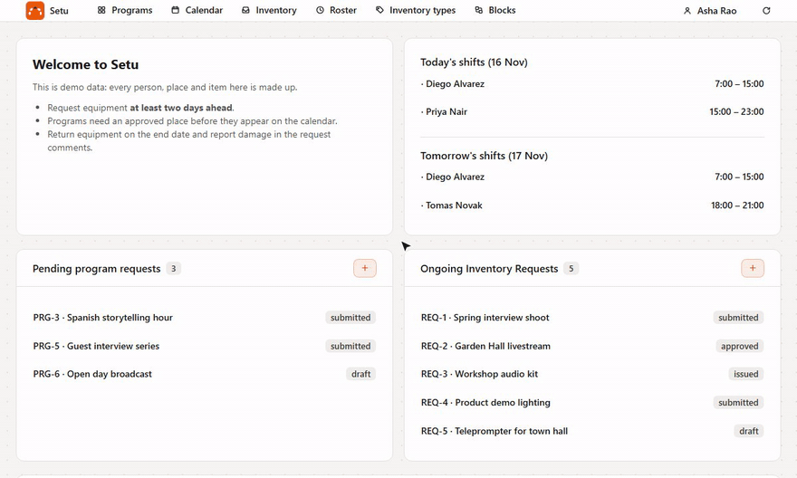
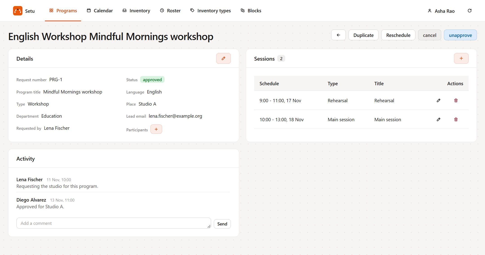
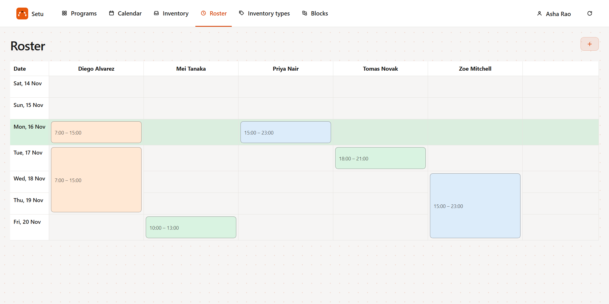

# Setu

_Setu (सेतु, "bridge"): the people who request, approve and run a studio, in one app._

[](https://github.com/live-miracles/setu/actions/workflows/ci.yml)
[](https://developer.mozilla.org/docs/Web/Progressive_web_apps)
[](docs/deployment.md#free-tier-deployment)
[](docs/getting-started.md)

**Program scheduling, equipment inventory, approvals and staff rosters for a studio team, in one installable web app that runs on free tiers.** Teams request equipment and sessions, approvers decide on them, and the crew sees who is on shift. It is a small internal app, built for up to 500 users and 100,000 records, that works in Chrome on desktop and mobile and installs to the home screen as a PWA.

It is also a compact, working reference for a **React + Supabase + Vercel** app with Google sign-in, role-based access, Postgres Row Level Security, Edge Functions, and an in-repo UI kit instead of a component library.

## Screenshots

<p align="center">
  
</p>

<p align="center">
  
</p>

<p align="center">
  
</p>

The GIF and screenshots use made-up data from the built-in demo, not a real organisation.
Run it yourself with `npm run demo`; see [Try it without Supabase](docs/getting-started.md#try-it-without-supabase).

## Features

- **Program requests and calendar.** Request sessions at a place, see a month
  calendar of approved programs, and rely on the app to block clashes (two approved
  programs can't use the same place within an hour of each other).
- **Equipment inventory.** Track types, brands, places, and individually labelled
  items. Print QR labels as a PDF, scan them with the phone camera, and attach
  photos that are compressed in the browser before upload.
- **Approval workflow.** Inventory and program requests share one lifecycle:
  submit, approve, reject, issue, close, cancel, revise, and reopen, enforced by a
  single policy module used by both the app and the API.
- **Comments and email.** Comments on every request, with email
  notifications to participants sent through the Gmail API.
- **Roster scheduling.** Shift types and per-person rosters for the crew.
- **Roles and access control.** `admin`, `approver`, `viewer`, and `user` roles, an
  email-domain allowlist, and Row Level Security in Postgres.
- **Built for phones.** Installable PWA, a bottom dock on mobile, and a
  list-and-detail layout on wide screens.
- **Costs nothing to run.** Fits within the free plans of Supabase and Vercel;
  a scheduled workflow keeps the free project from pausing.

## How it works

```text
Browser → Vercel static app → Supabase Auth
                           ├→ Edge Function: api
                           ├→ Postgres
                           └→ Storage
```

| Layer    | Technology                                                           |
| -------- | -------------------------------------------------------------------- |
| Frontend | React 19, TypeScript, Tailwind CSS 4, TanStack Query, React Router   |
| API      | Supabase Edge Function (`supabase/functions/api/`)                   |
| Database | Supabase Postgres with RLS and `pg_cron`                             |
| Auth     | Google OAuth through Supabase Auth                                   |
| Hosting  | Vercel serves the static build; GitHub Actions deploy Supabase       |
| Tests    | `node --test`, migrations run against an in-memory Postgres (PGlite) |

## Quick start

You need Node.js 26+, a Supabase project, and a Google OAuth client.

```bash
git clone https://github.com/live-miracles/setu.git
cd setu
npm install
cp .env.example .env.local   # add your Supabase URL and publishable key
npm run dev                  # http://localhost:47193
```

[Getting started](docs/getting-started.md) walks through the Supabase and Google
OAuth setup, applying the schema, and making yourself an admin.

> Local development and production share one Supabase project, so local work reads
> and writes live data. Use a test account and avoid bulk or destructive changes.

## Documentation

| Guide                                        | What's in it                                                          |
| -------------------------------------------- | --------------------------------------------------------------------- |
| [Getting started](docs/getting-started.md)   | Developer setup, roles, commands, project layout                      |
| [Deployment](docs/deployment.md)             | Free-tier limits, Vercel, automatic deploys, comment email, allowlist |
| [Database backups](docs/database-backups.md) | Encrypted weekly backups on the free plan, and restore steps          |
| [Troubleshooting](docs/troubleshooting.md)   | Fixes for the setup errors people hit most                            |
| [Security review](docs/security-review.md)   | Security controls and intentional design decisions                    |
| [Architecture decisions](docs/adr/)          | Why the app uses its own UI kit instead of Ant Design                 |
| [Domain glossary](CONTEXT.md)                | Terms used in the code: request, party, approver, place, and so on    |

## Contributing and security

Run `npm test`, `npm run typecheck`, and `npm run format:check` before opening a pull
request; the same checks run in CI. Repository conventions are in
[AGENTS.md](AGENTS.md). To report a vulnerability, follow [SECURITY.md](SECURITY.md)
and contact the repository owner privately instead of opening a public issue.

## License

[MIT](LICENSE) © Live Stream Miracles
